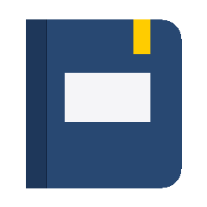

# 📝 RustNotes

<p align="center">
  
</p>

<p align="center">
  <strong>Aplikasi buku catatan digital (digital notebook) berkinerja tinggi yang terinspirasi dari Goodnotes, dibangun 100% menggunakan Pure Rust (Native Desktop GUI).</strong>
</p>

<p align="center">
  
  
  
  
  
</p>

---

## ⚡ Ikhtisar & Keunggulan

Sebagian besar aplikasi catatan modern dibangun menggunakan tumpukan teknologi berbasis web (Electron, Chromium, React, NodeJS) yang memakan ratusan megabyte RAM dan sering mengalami latensi inking. **RustNotes** dirancang dari nol menggunakan **Pure Rust** dengan pustaka Immediate Mode GUI **`eframe` / `egui 0.31`** yang berkomunikasi langsung dengan GPU (DirectX / OpenGL / WGPU).

### 📊 Perbandingan Metrik: Electron vs RustNotes

| Metrik | Aplikasi Catatan Berbasis Web/Electron | **RustNotes (Pure Rust)** |
|---|:---:|:---:|
| **Ukuran Executable** | 150 MB – 300 MB+ | **~5.5 MB** *(Single Standalone `.exe`)* |
| **Konsumsi Memori RAM** | 450 MB – 1.2 GB | **~75 MB – 95 MB** |
| **Waktu Startup** | 2 – 5 detik | **< 0.1 detik (Instan)** |
| **Mesin Render** | Web DOM / HTML Canvas / SVG | **Native GPU Immediate Mode Painter (60–144+ FPS)** |
| **Ketergantungan Eksternal** | Node.js, V8 Engine, Chromium Runtime | **Nol (Zero External Dependencies)** |
| **Undo / Redo Reliability** | Sering desinkronisasi pada state DOM | **Deterministik (Immutable Page Snapshot Stack)** |

---

## ✨ Fitur Utama

### 🖋️ 1. Mesin Inking & Peralatan Menggambar Halus
- **Pen & Pencil:** Interpolasi kurva kuadratik Bézier (*midpoint smoothing*) adaptif menjamin goresan bebas sudut patah tanpa latensi kursor.
- **Highlighter Bebas Tumpukan Gelap (*Overlap-Free*):** Menghasilkan pita stabil semi-transparan dengan potongan rata (*flat chisel ends*), mengeliminasi masalah warna menumpuk atau bintik gelap pada sambungan goresan.
- **Multi-layer Neon Laser Pointer:** Laser interaktif dengan lingkaran cahaya neon berlapis (*Ambient Aura, Mid Halo, Core Beam, White Hotspot*) dan efek peluruhan halus saat diam atau diangkat.
- **Smart Shape Recognition:** Tahan ujung pena selama $\approx 500$ ms di akhir goresan untuk otomatis merapikan goresan menjadi bentuk geometri sempurna (Garis lurus, Persegi, Segitiga, Lingkaran, Jajar Genjang).
- **Penghapus Cerdas:** Mode penghapus utuh (*Whole Stroke Eraser*) dengan *spatial index* cepat dan penghapus parsial (*Partial Stroke Splitter*).
- **Zoom Window:** Jendela bantuan penulisan detail halus dengan mekanisme *auto-advance* otomatis ke kanan saat mencapai batas tepi.
- **Palm Rejection:** Filter deteksi sentuhan telapak tangan yang menolak goresan palsu ketika multi-touch terdeteksi.

### 📐 2. Seleksi Lasso & Transformasi Objek Lengkap
- **Seleksi Fleksibel:** Melingkari objek dengan kurva lasso bebas (*Ray-casting point-in-polygon* dan deteksi perpotongan CCW).
- **Transformasi Bebas:** Menggeser (*move*), mengubah ukuran (*scale*), memutar dengan pivot sudut bebas (*rotation*), serta *flip* horizontal dan vertikal.
- **Manajemen Objek:** Salin, Potong, Tempel, Duplikasi, Ubah Urutan tumpukan (*Bring to Front / Send to Back*), dan ubah warna seleksi massal.
- **Sistem Clipboard Aplikasi:** Manajemen riwayat salinan independen berurutan waktu, terintegrasi mulus dengan clipboard gambar OS Windows (`Ctrl+V` langsung menempelkan foto).

### 📑 3. Manajemen Halaman & Dokumen Lanjutan
- **Rotasi Penuh Halaman (Full Page Rotation):** Memutar halaman sebesar 90° Searah Jarum Jam (CW), 90° Berlawanan Jarum Jam (CCW), atau 180°. Seluruh dimensi kertas, goresan pena, bentuk geometri, kotak teks, dan gambar ikut berputar dengan orientasi matematis yang presisi.
- **Pengaturan Urutan Halaman:** Drag-and-drop thumbnail halaman pada sidebar kiri untuk memindahkan urutan halaman secara instan.
- **Operasi Massal (*Bulk Actions*):** Seleksi beberapa halaman sekaligus untuk melakukan ekspor PDF massal, duplikasi, rotasi, atau penghapusan bersamaan.
- **Katalog Template Kertas:** Preset ukuran A4, Letter, A5, dan Legacy dengan orientasi Portrait/Landscape serta template *Blank*, *Ruled*, *Grid*, *Dotted*, dan *Cornell Notes*.

### 📂 4. Organisasi & Keandalan Data
- **Struktur Folder Bersarang (*Nested Folders*):** Tata catatan ke dalam hierarki folder bertingkat dengan navigasi *breadcrumb* yang bersih.
- **Pencarian Cerdas & OCR Tulisan Tangan:** Ekstraksi otomatis goresan tangan ke teks digital di latar belakang untuk pencarian dokumen global maupun per-buku (`Ctrl+F`).
- **Penyimpanan Atomik (*Atomic Writes*):** Penyimpanan aman ke `%APPDATA%\RustNotes\` melalui mekanisme `.tmp` $\rightarrow$ salinan cadangan `.previous.json` $\rightarrow$ penggantian atomik. Mencegah berkas korup jika terjadi pemadaman listrik tiba-tiba.
- **Impor & Ekspor Fleksibel:**
  - Impor PDF langsung ke halaman buku catatan via `pdfium`.
  - Ekspor dokumen penuh atau halaman terpilih ke berkas PDF vektor berkualitas tinggi atau gambar PNG resolusi tinggi.
  - Cadangkan dan bagikan dokumen dengan format berkas arsip portabel `.rnote` atau `.zip`.

---

## ⌨️ Pintasan Keyboard (Keyboard Shortcuts)

| Pintasan | Aksi |
|---|---|
| `Ctrl + Z` / `Ctrl + Y` | Membatalkan (*Undo*) / Mengulang (*Redo*) mutasi kanvas |
| `Ctrl + S` | Simpan dokumen saat ini secara instan |
| `Ctrl + F` | Buka pencarian teks & OCR di dalam buku catatan |
| `Ctrl + C` / `Ctrl + X` | Salin (*Copy*) / Potong (*Cut*) objek seleksi |
| `Ctrl + V` | Tempelkan (*Paste*) objek atau gambar dari clipboard |
| `Ctrl + D` | Duplikasi objek seleksi langsung di tempat |
| `P` / `H` / `E` / `L` / `T` | Pintasan alat: Pena (*Pen*), Stabilo (*Highlighter*), Penghapus (*Eraser*), Lasso, Teks |
| `Ctrl + Scroll` | Zoom in / Zoom out pada posisi kursor |
| `Ctrl + 0` | Mengembalikan tingkat pembesaran ke 100% (Reset Zoom) |
| `F1` / `?` | Buka dialog bantuan pintasan keyboard |

---

## 🚀 Memulai (Build from Source)

### Prasyarat
- **Sistem Operasi:** Windows 10 atau Windows 11 (64-bit).
- **Rust Toolchain:** Rust versi terbaru (edisi 2024 atau stabil $\ge 1.85$). Disarankan menggunakan toolchain `x86_64-pc-windows-msvc`.

### Langkah Kompilasi

1. **Clone repositori:**
   ```bash
   git clone https://github.com/rajaopak/RustNotes.git
   cd RustNotes/goodnotes-rust
   ```

2. **Jalankan pengujian unit (Unit Tests):**
   ```powershell
   cargo test
   ```

3. **Verifikasi kode dengan Clippy:**
   ```powershell
   cargo clippy --all-targets -- -D warnings
   ```

4. **Kompilasi biner Release:**
   ```powershell
   cargo build --release
   ```

File biner executable mandiri akan tersedia di:
```text
goodnotes-rust/target/release/rustnotes.exe
```

*(Ukuran binary hanya sekitar 5.5 MB, berjalan langsung tanpa memerlukan instalasi runtime tambahan).*

---

## 🏗️ Struktur Arsitektur Kode

Kode sumber diorganisir secara modular berdasarkan domain tanggung jawab tunggal:

```text
goodnotes-rust/
├── Cargo.toml                  # Konfigurasi dependensi dan profil rilis
├── pdfium.dll                  # Pustaka rendering PDF opsional
├── assets/                     # Aset ikon dan grafis antarmuka
└── src/
    ├── main.rs                 # Entry point, subsistem GUI Windows, konfigurasi viewport
    ├── lib.rs                  # Root crate library
    ├── model.rs                # Struktur data: Library, Notebook, Page, DrawObject, Template
    ├── storage.rs              # Penyimpanan atomik, ekspor PNG/PDF, import zip/rnote
    ├── crash_handler.rs        # Panic handler otomatis menulis log ke %APPDATA%\RustNotes\logs\
    ├── app/                    # Antarmuka Pengguna & Logika State Aplikasi
    │   ├── cover.rs            # Generator sampul buku realistis dengan pola dinamis
    │   ├── document_ops.rs     # Operasi duplikasi, hapus, dan pengurutan halaman
    │   ├── editor_navbar.rs    # Bilah alat atas Goodnotes-style (#284872) & pop-up alat
    │   ├── editor_sidebar.rs   # Panel thumbnail kiri dengan fitur drag-drop & seleksi massal
    │   ├── editor_view.rs      # Tampilan editor kanvas utama & sinkronisasi scroll
    │   ├── library_view.rs     # Galeri rak buku catatan, navigasi folder, dan pencarian global
    │   ├── modals.rs           # Dialog pembuatan buku, impor PDF/gambar, dan info About
    │   ├── state.rs            # State utama RustNotesApp
    │   ├── theme.rs            # Manajemen tema warna Goodnotes
    │   └── types.rs            # Tipe data UI & enum navigasi
    ├── canvas/                 # Mesin Render Kanvas & State Machine Peralatan
    │   ├── laser.rs            # Algoritma pita laser multi-layer bebas artifak
    │   ├── primitives.rs       # Render pola kertas (ruled, grid, dotted), teks, & gambar
    │   ├── render.rs           # Loop interaksi pointer, deteksi drag, dan painter GPU
    │   ├── state.rs            # Undo/Redo stack per-halaman & seleksi aktif
    │   ├── types.rs            # Enum alat (Pen, Pencil, Highlighter, Eraser, Lasso, dll.)
    │   ├── zoom_window.rs      # Jendela zoom interaktif dengan auto-scroll
    │   └── tests.rs            # Pengujian unit kanvas
    └── geometry/               # Kalkulasi Matematika 2D Murni (Zero UI Dependencies)
        ├── primitives.rs       # Perhitungan bounding box akurat per objek & gabungan
        ├── transform.rs        # Rotasi halaman, translasi, rotasi sudut, dan flip objek
        ├── hit_test.rs         # Deteksi sentuhan kursor & pengujian objek di dalam lasso
        ├── tessellation.rs     # Tessellator pita segitiga (triangle strip) goresan & stabilo
        ├── spatial_grid.rs     # Akselerasi spasial grid untuk hit-test cepat di halaman padat
        ├── shapes.rs           # Algoritma pengenalan bentuk otomatis (Shape Recognition)
        ├── eraser.rs           # Logika pemotongan goresan sebagian (Stroke Splitter)
        ├── palm_rejection.rs   # Filter penolakan sentuhan telapak tangan
        ├── ocr.rs              # Ekstraksi OCR fitur tulisan tangan berbasis topologi goresan
        └── tests.rs            # Pengujian unit geometri
```

---

## 🛡️ Keamanan & Privasi Data

- **100% Offline & Lokal:** Semua catatan, buku, folder, dan berkas aset disimpan secara lokal di komputer pengguna (`%APPDATA%\RustNotes\`). Tidak ada data atau telemetri yang dikirimkan ke server eksternal mana pun.
- **Pencegahan Berkas Korup:** Jika terjadi kegagalan tak terduga saat penulisan file, RustNotes otomatis memulihkan berkas dari `.previous.json` dan mengarantina file yang bermasalah tanpa menghapus data pengguna secara diam-diam.

---

## 📄 Lisensi

Proyek ini dilisensikan di bawah lisensi terbuka [MIT License](LICENSE).
Bebas digunakan, dimodifikasi, dan didistribusikan untuk keperluan pribadi maupun komersial.
